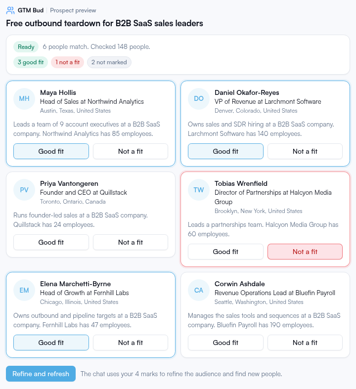
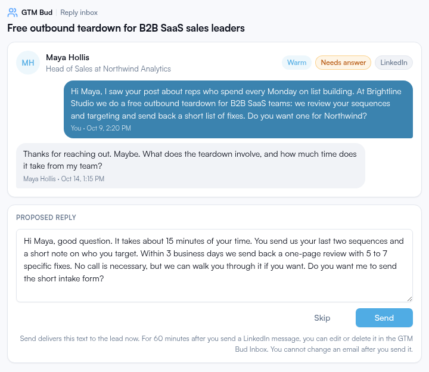

# GTM Bud MCP connector

The GTM Bud connector connects your AI assistant to GTM Bud, so you can build and monitor LinkedIn outbound campaigns in the chat.

The connector is a remote MCP server. It works in Claude, ChatGPT, Claude Code, Cursor, VS Code and Codex. You install no local code. You sign in to GTM Bud with OAuth when you use the connector for the first time.

```text
https://gtmbud.com/mcp
```

[GTM Bud](https://gtmbud.com/?utm_source=github&utm_medium=readme&utm_campaign=github-oss&utm_content=gtmbud-mcp) | [Connector overview](https://gtmbud.com/gtm-bud-connector?utm_source=github&utm_medium=readme&utm_campaign=github-oss&utm_content=gtmbud-mcp) | [Support](https://gtmbud.com/support?utm_source=github&utm_medium=readme&utm_campaign=github-oss&utm_content=gtmbud-mcp)

## Contents

- [What you can do](#what-you-can-do)
- [All tools](#all-tools)
- [Requirements](#requirements)
- [Setup](#setup): [Claude](#claude), [ChatGPT](#chatgpt), [Claude Code](#claude-code), [Cursor](#cursor), [VS Code](#vs-code), [Codex](#codex)
- [Claude Code plugin](#claude-code-plugin)
- [Privacy and support](#privacy-and-support)
- [License](#license)

## What you can do

Write your request in your own words. The assistant uses GTM Bud to do the work, and you stay in the chat.

### Build a full campaign from one sentence

Describe your audience in one sentence. The assistant writes the ideal customer profile, checks the targeting criteria, shows real matching prospects, writes the value offers and the message sequence, and launches the campaign after you confirm.

> "Build a campaign for heads of sales at software companies in Germany."

### See real prospects before you launch

The assistant searches for real people that match your audience and shows them in the chat. Mark each person **Good fit** or **Not a fit**, and the assistant refines the audience from your marks.

> "Show me real people this campaign would reach, then tighten the audience."



### Answer replies with an AI that knows your context

The assistant reads the full conversation, writes a reply with your offer and your reply playbooks, and shows it for you to edit. Nothing is sent until you click **Send**. You can also change the playbooks that GTM Bud follows.

> "Which replies need an answer? Write a reply to the newest one."



### Get results and weekly reviews

See the reply rate, the replies by label and the connection request acceptance rate for each campaign. The [Claude Code plugin](#claude-code-plugin) adds a weekly review that grades each campaign and gives 3 next actions.

> "Run my weekly campaign review."

### Control your campaigns

Change the sending mode, start or stop lead finding, copy a campaign to a new draft, or end a campaign. Each change that starts sending shows a preview and waits for your confirmation.

> "Pause lead finding on my oldest campaign, and duplicate it for the UK."

### Upgrade your LinkedIn profile

GTM Bud reads your LinkedIn profile and your company website. It writes headline, About and button options, and makes banner and profile photo options. The work runs in the background and can take 30 minutes. You can ask for revisions. Profile upgrades are available on selected accounts. Ask support@gtmbud.com.

> "Upgrade my LinkedIn profile, then make the headline shorter."

## All tools

The connector has 36 tools. The 4 profile upgrade tools show only on accounts where GTM Bud turned them on. The tool names are in parentheses.

#### Campaign results

- List campaigns (`list_campaigns`)
- Get campaign results (`get_campaign_results`)
- List campaign leads (`list_campaign_leads`)
- Remove a lead (`remove_lead`)
- List sending accounts (`list_sending_accounts`)

#### Replies

- List replies (`list_replies`)
- Get conversation (`get_conversation`)
- Review a reply (`review_reply`)
- Send a reply (`send_reply`)
- Label a reply (`classify_reply`)
- Get reply playbooks (`get_reply_playbooks`)
- Update a reply playbook (`update_reply_playbook`)

#### Build and launch a campaign

- Create a campaign draft (`create_campaign_draft`)
- Update campaign targeting (`update_campaign_targeting`)
- Duplicate a campaign (`duplicate_campaign`)
- Start a prospect preview (`start_prospect_preview`)
- Get a prospect preview (`get_prospect_preview`)
- Get a prospect profile (`get_prospect_profile`)
- Mark a prospect fit (`mark_prospect_fit`)
- Get the seller profile (`get_seller_profile`)
- Update the seller profile (`update_seller_profile`)
- Get the value offer brief (`get_value_offer_brief`)
- Save value offers (`save_value_offers`)
- Get the sequence brief (`get_sequence_brief`)
- Get the campaign sequence (`get_campaign_sequence`)
- Save the campaign sequence (`save_campaign_sequence`)
- Get the launch readiness (`get_launch_readiness`)
- Launch a campaign (`launch_campaign`)

#### Campaign controls

- Get campaign controls (`get_campaign_controls`)
- Set the sending mode (`set_sending_mode`)
- Set lead finding (`set_lead_finding`)
- End a campaign (`end_campaign`)

#### Profile upgrades

- Request a profile upgrade (`request_profile_upgrade`)
- Revise a profile upgrade (`revise_profile_upgrade`)
- Get a profile upgrade (`get_profile_upgrade`)
- List profile upgrades (`list_profile_upgrades`)

The assistant sends a reply only after you approve the text. A campaign launches only after you confirm a preview. Changes that start sending also need your confirmation.

## Requirements

- A GTM Bud account. If you do not have an account, you can make one in the sign-in window that opens when you add the connector.
- At least one LinkedIn account that is connected on gtmbud.com. You cannot connect LinkedIn in the chat.
- Sending accounts and a sending schedule for each campaign. You set these on gtmbud.com.

The GTM Bud trial is 14 days. The trial starts when you launch your first campaign, not when you sign up. You do not need a credit card.

## Setup

Use the same connector URL in each app:

```text
https://gtmbud.com/mcp
```

### Claude

These steps are for claude.ai, Claude Desktop and Cowork on the Pro and Max plans.

1. Go to **Customize > Connectors**.
2. Click **+ Add**, then click **Add custom connector**.
3. Type the name `GTM Bud`.
4. Type the URL `https://gtmbud.com/mcp`, then click **Continue**.
5. Keep the authentication settings that Claude finds, then click **Continue**.
6. Keep the recommended sign-in settings, then click **Add**.
7. Sign in to GTM Bud in the window that opens, then select **Allow**.
8. In a chat, click **+**, then **Connectors**, and turn on GTM Bud.

On the Team and Enterprise plans, an Owner adds the connector in **Organization settings > Connectors** first. Then each member goes to **Customize > Connectors** and clicks **Connect**. The Free plan permits one custom connector.

More detail: [GTM Bud for Claude](https://gtmbud.com/gtm-bud-for-claude?utm_source=github&utm_medium=readme&utm_campaign=github-oss&utm_content=gtmbud-mcp).

### ChatGPT

1. Go to [ChatGPT Plugins](https://chatgpt.com/plugins).
2. Select the plus button, then select **Add custom MCP server**.
3. Type the name `GTM Bud` and, if you want, a description.
4. Under **Connection**, type the URL `https://gtmbud.com/mcp`.
5. Set the authentication to OAuth.
6. Read the risk warning, then select **I understand and want to continue**.
7. Select **Create as a plugin**, then install the plugin.
8. Sign in to GTM Bud in the window that opens, then select **Allow**.
9. Start a new conversation. Type `@` and select GTM Bud.

Your account and workspace policies apply. In a managed workspace, an admin can control custom MCP servers.

More detail: [GTM Bud for ChatGPT](https://gtmbud.com/gtm-bud-for-chatgpt?utm_source=github&utm_medium=readme&utm_campaign=github-oss&utm_content=gtmbud-mcp).

### Claude Code

Run this command:

```bash
claude mcp add --transport http gtm-bud https://gtmbud.com/mcp
```

To add the connector for all your projects, add `--scope user` to the command.

In Claude Code, run `/mcp`, select `gtm-bud` and sign in to GTM Bud in your browser.

You can also install the [Claude Code plugin](#claude-code-plugin). The plugin adds the connector and a weekly campaign review skill.

More detail: [GTM Bud for coding agents](https://gtmbud.com/gtm-bud-for-coding-agents?utm_source=github&utm_medium=readme&utm_campaign=github-oss&utm_content=gtmbud-mcp).

### Cursor

Add this server to `~/.cursor/mcp.json` for all projects, or to `.cursor/mcp.json` for one project:

```json
{
  "mcpServers": {
    "gtm-bud": {
      "url": "https://gtmbud.com/mcp"
    }
  }
}
```

Cursor then asks you to sign in to GTM Bud. Sign in and select **Allow**.

You can also open this install link in your browser. GitHub does not make `cursor://` links clickable, so copy the link:

```text
cursor://anysphere.cursor-deeplink/mcp/install?name=gtm-bud&config=eyJ1cmwiOiJodHRwczovL2d0bWJ1ZC5jb20vbWNwIn0=
```

More detail: [GTM Bud for coding agents](https://gtmbud.com/gtm-bud-for-coding-agents?utm_source=github&utm_medium=readme&utm_campaign=github-oss&utm_content=gtmbud-mcp).

### VS Code

1. Open the Command Palette and run **MCP: Open User Configuration**. For one workspace, use `.vscode/mcp.json`.
2. Add this server:

```json
{
  "servers": {
    "gtm-bud": {
      "type": "http",
      "url": "https://gtmbud.com/mcp"
    }
  }
}
```

3. Start the server. Sign in to GTM Bud in your browser and select **Allow**.

### Codex

Run these commands:

```bash
codex mcp add gtm-bud --url https://gtmbud.com/mcp
codex mcp login gtm-bud
```

You can also add the server to `~/.codex/config.toml`:

```toml
[mcp_servers.gtm-bud]
url = "https://gtmbud.com/mcp"
```

Then run `codex mcp login gtm-bud`.

More detail: [GTM Bud for coding agents](https://gtmbud.com/gtm-bud-for-coding-agents?utm_source=github&utm_medium=readme&utm_campaign=github-oss&utm_content=gtmbud-mcp).

## Claude Code plugin

This repository is also a Claude Code plugin marketplace. The `gtm-bud` plugin contains:

- The GTM Bud connector at `https://gtmbud.com/mcp`.
- The skill `weekly-campaign-review`. Ask Claude "Run my weekly campaign review". Claude grades the connection request acceptance rate of each active campaign, lists the replies that need an answer and the sending account problems, and gives 3 next actions.

To install the plugin, run these commands in Claude Code:

```text
/plugin marketplace add startino/gtmbud-mcp
/plugin install gtm-bud@gtmbud
```

Then confirm the install in the panel that opens.

You can also run the same steps in your shell:

```bash
claude plugin marketplace add startino/gtmbud-mcp
claude plugin install gtm-bud@gtmbud
```

Then run `/mcp` and sign in to GTM Bud.

If you added the connector with `claude mcp add` before, remove that server to prevent a duplicate:

```bash
claude mcp remove gtm-bud
```

The plugin runs no local code. Claude calls the GTM Bud connector over HTTPS. The plugin sends data to no other service.

## Privacy and support

The connector acts only on the GTM Bud account that signed in and selected **Allow**. To remove access, remove the connector in your app, or remove it under Connected AI apps in GTM Bud Settings.

- [Privacy policy](https://gtmbud.com/privacy?utm_source=github&utm_medium=readme&utm_campaign=github-oss&utm_content=gtmbud-mcp)
- [Terms](https://gtmbud.com/terms?utm_source=github&utm_medium=readme&utm_campaign=github-oss&utm_content=gtmbud-mcp)
- [Support](https://gtmbud.com/support?utm_source=github&utm_medium=readme&utm_campaign=github-oss&utm_content=gtmbud-mcp)

When you contact support, tell us which app you use and what you tried.

## License

The files in this repository use the [MIT License](LICENSE). Your use of the GTM Bud service follows the [GTM Bud terms](https://gtmbud.com/terms?utm_source=github&utm_medium=readme&utm_campaign=github-oss&utm_content=gtmbud-mcp).
